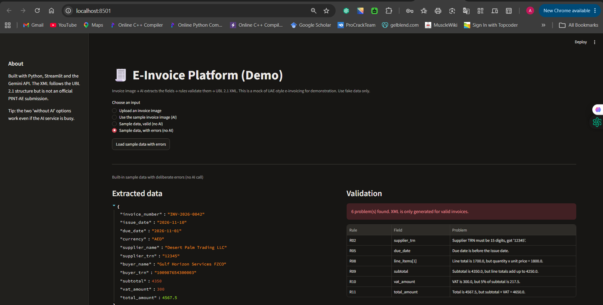

# E-Invoice Platform (Demo)


[](https://einvoice-platform-gqkssavfmmblqxacg8ydpd.streamlit.app/)

A small demo that turns an invoice image into a validated, UAE-style e-invoice (UBL 2.1 XML), with an AI-assisted "Report a problem" feature that suggests fixes and checks them before they are applied.

> **Demo only.** This is a mock built on fake data. It is not an official UAE FTA / PINT-AE submission, and the XML has not been certified by any accredited provider.

## Try the live demo

**Live app:** https://einvoice-platform-gqkssavfmmblqxacg8ydpd.streamlit.app/

The app sleeps when idle. If you see a "Wake up" button, click it and wait about 30 seconds.

A 2-minute walkthrough:

1. Choose **Sample data, with errors (no AI)** and click **Load sample data with errors**. Six rule violations are listed and no XML is produced.
2. Open **Report a problem**, type `Supplier TRN is 100123456700003 and the due date should be 2026-12-10`, and click **Suggest a fix**. Review the proposed changes, then click **Apply this fix**.
3. The invoice now passes all rules and the UBL XML can be downloaded.
4. Optional (uses the AI): choose **Upload an invoice image** and upload [this sample invoice](https://github.com/Tony-techno/einvoice-platform/raw/main/sample_invoices/invoice_001.png) to see the fields extracted from an image.

## What it does

1. **Extracts** invoice fields (parties, TRNs, dates, line items, totals) from an image using the Gemini API.
2. **Validates** them against 11 business rules (TRN format, dates, line totals, 5% VAT, grand total).
3. **Generates** a UBL 2.1 XML invoice, only if the invoice passes validation.
4. **Suggests fixes** when something is wrong. You can describe the problem, attach a screenshot, or both. The AI proposes a correction, the app shows exactly what would change, the rules re-check the result, and nothing is applied until you click **Apply this fix**.

### Screenshots

A valid invoice, with the generated XML ready to download:


An invalid invoice, with each broken rule listed:



## Try it in 5 minutes

You need Python 3.12 and Git.

```
git clone https://github.com/Tony-techno/einvoice-platform.git
cd einvoice-platform
python -m venv .venv
.\.venv\Scripts\Activate.ps1
pip install -r requirements.txt
streamlit run app/main.py
```

(On macOS or Linux, activate with `source .venv/bin/activate`.)

In the app, pick **Sample data, valid (no AI)** or **Sample data, with errors (no AI)**. Both work **without any API key**.

To use the AI features (reading an invoice image, suggesting fixes), get a free key from [Google AI Studio](https://aistudio.google.com), copy `.env.example` to `.env`, and put your key in it.

Run the tests (no key needed):

```
pip install -r requirements-dev.txt
python -m pytest -q
```

## Validation rules

| Rule | Check |
|---|---|
| R01 | Invoice number present |
| R02, R03 | Supplier and buyer TRN are exactly 15 digits |
| R04, R05 | Dates are valid; due date is not before issue date |
| R06 | Currency is AED |
| R07 | At least one line item |
| R08 | Line total = quantity x unit price |
| R09 | Subtotal = sum of line totals |
| R10 | VAT = 5% of subtotal |
| R11 | Total = subtotal + VAT |

These rules are a simplified demo, not the official rule set.

## Tech used

Python, Streamlit, Pydantic, Gemini API (free tier, with automatic fallback to a backup model when one is busy), UBL 2.1 XML, pytest, GitHub Actions (tests run on every push), Git/GitHub.

## Project structure

```
app/          the application (extraction, validation, XML, fixer, UI)
tests/        automated tests
scripts/      one-off diagnostic scripts
sample_invoices/  fake invoice used for the demo
docs/         screenshots and an example XML output
```

## Known limitations

- Uses the free Gemini tier, so the AI features can occasionally be slow or unavailable when the service is busy. The "no AI" options are unaffected.
- AI suggestions can be wrong, which is why every suggestion is re-validated and needs a click to apply.
- Use fake data only. Free-tier prompts may be used by Google to improve its products.

## Roadmap

Built so far, using free tools only (no billing account): extraction, validation, XML generation, AI-assisted fixes, automated tests, and a live deployment.

Planned next, also free: a daily summary job and file-triggered processing using GitHub Actions, results logging with DuckDB and SQL, a Docker image built in CI, Telegram and email notifications, and a 2FA login. Google Cloud services that need a billing account (such as Cloud Run and Cloud Scheduler) are intentionally not used.