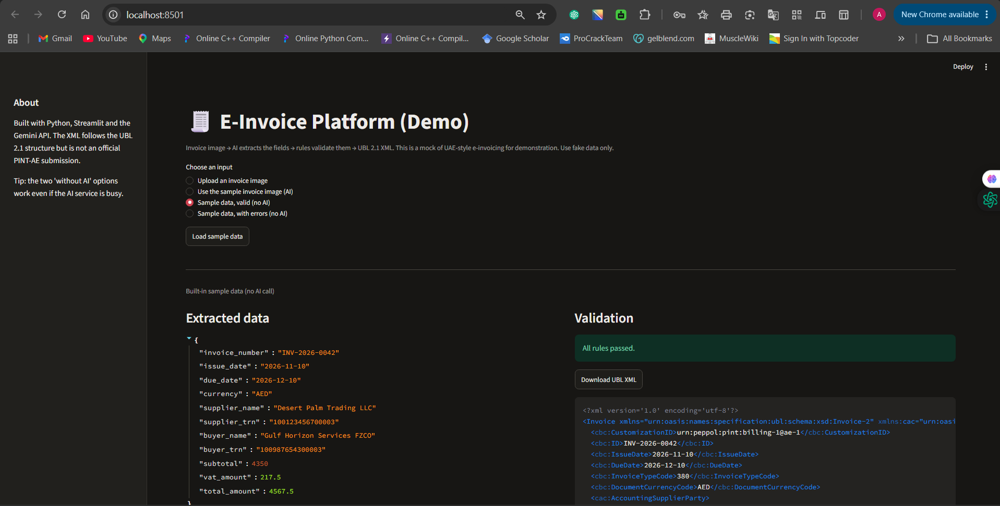
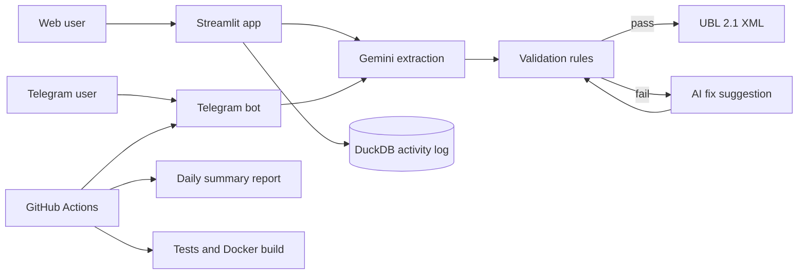

# E-Invoice Platform (Demo)


[](https://einvoice-platform-gqkssavfmmblqxacg8ydpd.streamlit.app/)

A small demo that turns an invoice image into a validated, UAE-style e-invoice (UBL 2.1 XML). An AI-assisted "Report a problem" feature suggests fixes and checks them before they are applied. Everything is built with free tools and no billing account.

> **Demo only.** This is a mock built on fake data. It is not an official UAE FTA / PINT-AE submission, and the XML has not been certified by any accredited provider.

## Try the live demo

**Live app:** https://einvoice-platform-gqkssavfmmblqxacg8ydpd.streamlit.app/

The app sleeps when idle. If you see a "Wake up" button, click it and wait about 30 seconds.

A 2-minute walkthrough:

1. On the sign-in page, click **Continue as demo user**. (An admin sign-in with a Google Authenticator code also exists. It unlocks export and clear tools for the activity log.)
2. Choose **Sample data, with errors (no AI)** and click **Load sample data with errors**. Six rule violations are listed and no XML is produced.
3. Open **Report a problem**, type `Supplier TRN is 100123456700003 and the due date should be 2026-12-10`, and click **Suggest a fix**. Review the proposed changes, then click **Apply this fix**.
4. The invoice now passes all rules and the UBL XML can be downloaded.
5. Open **Analytics** at the bottom to see SQL statistics from the activity log.
6. Optional (uses the AI): choose **Upload an invoice image** and upload [this sample invoice](https://github.com/Tony-techno/einvoice-platform/raw/main/sample_invoices/invoice_001.png).

### Screenshots

A valid invoice, with the generated XML ready to download:



An invalid invoice, with each broken rule listed:


## How it fits together



## What it does

1. **Extracts** invoice fields (parties, TRNs, dates, line items, totals) from an image using the Gemini API, with an automatic fallback to a backup model when one is busy.
2. **Validates** them against 11 business rules (TRN format, dates, line totals, 5% VAT, grand total).
3. **Generates** a UBL 2.1 XML invoice, only if the invoice passes validation.
4. **Suggests fixes** when something is wrong. You can describe the problem, attach a screenshot, or both. The AI proposes a correction, the app shows exactly what would change, the rules re-check the result, and nothing is applied until you click **Apply this fix**.
5. **Logs activity** to a DuckDB database and shows SQL-based statistics in an Analytics section.
6. **Runs automatically** on GitHub: tests on every push, a daily summary report, a Telegram bot, and a Docker image build.

## Other ways in

**Telegram bot:** [@anvesh_invoice_demo_bot](https://t.me/anvesh_invoice_demo_bot). Send a photo of an invoice and it replies with PASS or FAIL and the list of problems. It runs on GitHub Actions, not on a server, so it only answers when GitHub starts a run. Free scheduled runs can be minutes or hours apart.. For instant replies the owner starts a "live window" from the Actions tab. Send fake invoices only.

**Daily report:** a scheduled GitHub Actions job generates synthetic invoices every day, validates them, builds XML for the valid ones, summarises the results with SQL, and commits [the report](https://github.com/Tony-techno/einvoice-platform/blob/main/reports/daily_summary.md) to this repo.

**Docker:** the `Dockerfile` is built, started and health-checked by GitHub Actions on every push, and the image is published to GitHub Container Registry.

## Tools used and where

| Tool | Where it is used |
|---|---|
| Python, Pydantic | Application logic and data models |
| Streamlit | Web interface, deployed on Streamlit Community Cloud |
| Gemini API (free tier) | Invoice extraction and fix suggestions |
| SQL, DuckDB | Activity log and analytics, and the daily summary |
| UBL 2.1 XML | Mock e-invoice output |
| pytest | Automated tests, including mocked tests for the AI and bot code |
| Git, GitHub | Version control |
| GitHub Actions | Tests, daily report, Telegram bot runner, Docker build and publish |
| Docker, GitHub Container Registry | Container image of the app |
| Telegram Bot API | Invoice checking from chat |
| Google Authenticator (TOTP, pyotp) | Admin sign-in with a one-time code |

## Run it yourself

You need Python 3.12 and Git.

```
git clone https://github.com/Tony-techno/einvoice-platform.git
cd einvoice-platform
python -m venv .venv
.\.venv\Scripts\Activate.ps1
pip install -r requirements.txt
streamlit run app/main.py
```

(On macOS or Linux, activate with `source .venv/bin/activate`.)

The **demo user** and the two "no AI" sample options work **without any API key**. To use the AI features, get a free key from [Google AI Studio](https://aistudio.google.com), copy `.env.example` to `.env`, and put your key in it.

Run the tests (no key needed):

```
pip install -r requirements-dev.txt
python -m pytest -q
```

With Docker installed:

```
docker build -t einvoice-platform .
docker run -p 8501:8501 -e GEMINI_API_KEY=your-key einvoice-platform
```

## Validation rules

| Rule | Check |
|---|---|
| R01 | Invoice number present |
| R02, R03 | Supplier and buyer TRN are exactly 15 digits |
| R04, R05 | Dates are valid; due date is not before issue date |
| R06 | Currency is AED |
| R07 | At least one line item |
| R08 | Line total = quantity x unit price |
| R09 | Subtotal = sum of line totals |
| R10 | VAT = 5% of subtotal |
| R11 | Total = subtotal + VAT |

These rules are a simplified demo, not the official rule set.

## Project structure

```
app/              the application (extraction, validation, XML, fixer, login, database, bot)
tests/            automated tests
scripts/          runners and one-off diagnostic scripts
sample_invoices/  fake invoice used for the demo
docs/             screenshots and an example XML output
reports/          daily summaries written by GitHub Actions
.github/workflows/  tests, daily report, Telegram bot, Docker build
```

## Known limitations

- Uses the free Gemini tier, so the AI features can occasionally be slow or unavailable when the service is busy. The "no AI" options are unaffected.
- AI suggestions can be wrong, which is why every suggestion is re-validated and needs a click to apply.
- The activity log is a local DuckDB file, so on the free host it resets when the app restarts.
- The Telegram bot's scheduled replies can take minutes or hours, because GitHub's free scheduler is best-effort. A live window (Actions, then Telegram bot, then Run workflow) gives replies within seconds.
- The daily report is started by the same best-effort scheduler, so it can begin hours after its scheduled time.
- GitHub pauses scheduled workflows in a public repo after about 60 days without activity.
- Use fake data only. Free-tier prompts may be used by Google to improve its products.
- Google Cloud services that need a billing account (such as Cloud Run and Cloud Scheduler) are intentionally not used.

## Possible next steps

Email delivery of the daily summary, a Google Sheets export, a wireframe in Penpot, Material 3 styling, infrastructure-as-code with Terraform, push notifications, and a Flutter client.